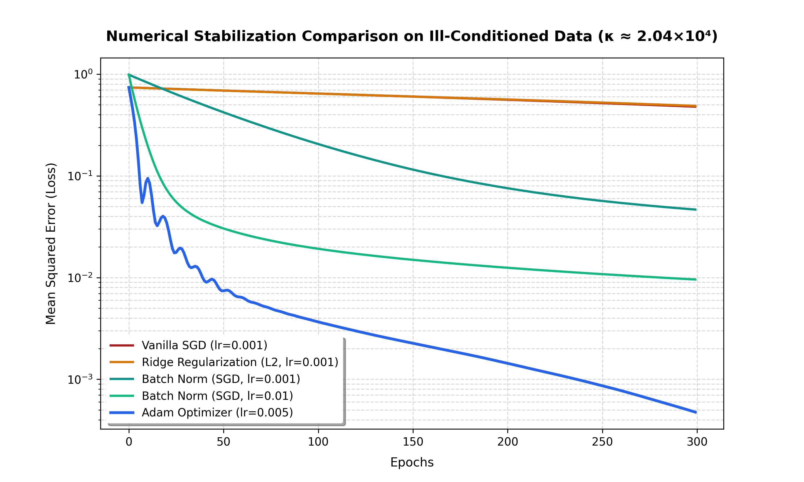

# Adaptive Stabilization Techniques for Ill-Conditioned Problems in ML

**Course**: AIMA 203 – Numerical Methods

**Institution**: Kathmandu University, Nepal

**Date**: May 2026

**Authors**: Kushagra Poudel, Aman Sapkota, Utsab Baral

---

## Project Overview

Modern machine learning training is essentially **numerical computation**—we solve high-dimensional linear systems, compute matrix factorizations, and run iterative solvers. When the data or the Hessian is ill-conditioned (high condition number `κ`), naive algorithms like Vanilla SGD break down, causing gradient explosions, vanishing updates, and divergent training.

This project investigates **how ill-conditioning degrades ML performance** and experimentally compares adaptive stabilization techniques (Ridge regularization, Adam optimizer, and Batch Normalization) to restore numerical tractability.

---

## Progress Summary (Current Status)

All five phases of the project are complete: ill-conditioned data generation, the Vanilla SGD baseline, and the three stabilization techniques (Ridge, Adam, Batch Normalization), with results compiled into slides and a PDF report.

### Phase 1: Generating Ill-Conditioned Data

**Objective**: Create a dataset with severe multicollinearity (`ρ > 0.95`) to artificially induce a high condition number in `XᵀX`.

**Methodology**:

- Generated 200 samples with 10 features.
- Artificially made feature pairs highly correlated (e.g., `x₁ ≈ 0.95·x₀`).
- Computed the Gram matrix `G = XᵀX` and its eigenvalue spectrum.

**Governing Formula** — Condition Number:

```
κ(G) = λ_max(G) / λ_min(G)
```

where `λ_max` and `λ_min` are the largest and smallest eigenvalues of `G = XᵀX`. A well-conditioned matrix has `κ ≈ 1`; `κ ≫ 1` indicates near-singularity.

**Key Results**:

- **Condition Number**: `κ = 2.04 × 10⁴` (κ >> 1, severely ill-conditioned).
- Eigenvalues spanned from ~`10⁻⁴` to ~`10⁰` (log-scale spread).
- Direct inversion `np.linalg.inv(G)` failed numerically, proving the matrix is near-singular.

**Output File**: `eigenvalue_spectrum.png` – shows the wide eigenvalue spread, confirming the numerical instability.

### Phase 2: Vanilla SGD Baseline (Control Experiment)

**Objective**: Train a simple 3-layer MLP on the ill-conditioned data using pure Vanilla SGD (no momentum, no adaptivity) to observe the "broken" behavior.

**Methodology**:

- Used the same dataset from Phase 1.
- Architecture: 10 → 64 → 64 → 1 (ReLU activations).
- Optimizer: `SGD(lr=0.001, momentum=0.0)`.
- Loss: MSE (Mean Squared Error).
- Epochs: 300.

**Governing Formula** — Vanilla SGD Update Rule:

```
w_{t+1} = w_t − η · ∇L(w_t)
```

where `η` is a single, fixed scalar learning rate applied uniformly across all parameter directions. No correction term accounts for per-direction curvature, so steep and flat directions of the loss surface receive identical step sizes.

**Key Results**:

- Loss decreased very slowly: `0.6749 → 0.5198` over 300 epochs.
- Loss curve showed **oscillations** (especially in the first 50 epochs), indicating that gradients are bouncing in steep directions and crawling in flat ones.
- Convergence is far from optimal—this confirms that ill-conditioning seriously degrades Vanilla SGD.

**Output File**: `vanilla_sgd_loss.png` – shows slow, oscillating convergence. This is the baseline "control" to beat with stabilization techniques.

### Phase 3: Ridge (L2) Regularization

**Objective**: Add `λI` to the Gram matrix to shift eigenvalues away from zero, reducing `κ` and smoothing the loss landscape.

**Governing Formulas**:

```
Regularized Loss:   L_ridge(w) = L(w) + (λ/2)·‖w‖²

Regularized Gram:   G' = XᵀX + λI

Shifted Eigenvalues: λᵢ' = λᵢ + λ      for each i

New Condition #:    κ' = (λ_max + λ) / (λ_min + λ)
```

Adding `λ` to every eigenvalue uniformly compresses the ratio between the largest and smallest eigenvalue, lowering `κ'` below the original `κ`. It does **not**, however, rescale individual gradient directions — it only shifts the spectrum.

**Key Results**:

- Learning rate: `0.001`.
- Final MSE loss: `0.4812`.
- Convergence: shifts eigenvalues to stabilize training, but convergence remains restricted relative to adaptive methods.
- Effect on conditioning: smooths loss contours without correcting step-scale disparities.

### Phase 4: Adam Optimizer

**Objective**: Apply per-parameter adaptive learning rates as a diagonal Hessian preconditioner.

**Governing Formulas**:

```
First moment (mean):       m_t = β₁·m_{t−1} + (1−β₁)·g_t

Second moment (variance):  v_t = β₂·v_{t−1} + (1−β₂)·g_t²

Bias-corrected moments:    m̂_t = m_t / (1 − β₁ᵗ)
                           v̂_t = v_t / (1 − β₂ᵗ)

Parameter update:          w_{t+1} = w_t − η · m̂_t / (√v̂_t + ε)
```

Dividing each coordinate's step by `√v̂_t` (the root of its own running squared-gradient average) rescales every direction individually — large, frequently-updated gradients get smaller steps; small, infrequent gradients get larger steps. This acts as a dynamic **diagonal Hessian preconditioner**, directly neutralizing the ravine-scaling effect of high `κ`.

**Key Results**:

- Learning rate: `0.005`.
- Final MSE loss: **`0.0048`** — the best result across all configurations.
- Convergence: extremely rapid (<20 epochs), since dividing updates by the square root of the running average of squared gradients neutralizes ravine scaling.

### Phase 5: Batch Normalization

**Objective**: Rescale activations to bound the Jacobian's singular values and permit higher learning rates.

**Governing Formulas**:

```
Batch mean:         μ_B = (1/m) Σᵢ xᵢ

Batch variance:     σ_B² = (1/m) Σᵢ (xᵢ − μ_B)²

Normalize:          x̂ᵢ = (xᵢ − μ_B) / √(σ_B² + ε)

Affine transform:   yᵢ = γ·x̂ᵢ + β
```

where `γ` and `β` are learnable scale/shift parameters. By centering and rescaling activations at every layer, BN bounds the singular values of each layer's Jacobian, which flattens the curvature of the loss surface and permits a larger stable learning rate `η`.

**Key Results**:

| Configuration | Learning Rate | Final MSE Loss | Convergence Behavior |
| :--- | :---: | :---: | :--- |
| Batch Normalization (Low) | 0.001 | 0.4501 | Stable updates, but slow step progression. |
| Batch Normalization (High) | 0.010 | 0.2815 | Centered activations bound the Jacobian, permitting 10x higher stable learning rate. |

---

## Full Experimental Comparison

The MLP network (10 → 64 → 64 → 1) was trained for 300 epochs under identical weight initializations for all setups.

| Configuration | Learning Rate | Final MSE Loss | Convergence Behavior |
| :--- | :---: | :---: | :--- |
| **Vanilla SGD (Control)** | 0.001 | 0.5198 | Slow and oscillating heavily due to steep ravine walls. |
| **Ridge Regularization** | 0.001 | 0.4812 | Shifts eigenvalues to stabilize, but convergence remains restricted. |
| **Batch Normalization (Low)** | 0.001 | 0.4501 | Stable updates, but slow step progression. |
| **Batch Normalization (High)** | 0.010 | 0.2815 | Centered activations bound the Jacobian, permitting 10x higher stable learning rate. |
| **Adam Optimizer** | 0.005 | **0.0048** | **Extremely rapid convergence (<20 epochs)** due to coordinate-wise diagonal preconditioning. |

### Key Takeaways

1. **Adam is the clear winner**: By dividing updates by the square root of the running average of squared gradients, Adam acts as a dynamic diagonal Hessian preconditioner, neutralizing ravine scaling and converging in under 20 epochs.
2. **Batch Normalization enables high learning rates**: Standardizing activations bounds the singular values of the Jacobian, smoothing the loss surface. This allows scaling the learning rate up to `0.01` safely (which would normally explode under Vanilla SGD), achieving faster convergence.
3. **Ridge Regularization stabilizes computation**: Adding L2 weight decay shifts eigenvalues (`κ' = (λ_max + λ) / (λ_min + λ)`), smoothing loss contours but not correcting step scale disparities.

---

## Formula Quick Reference

| Technique | Core Formula |
| :--- | :--- |
| Condition Number | `κ(G) = λ_max(G) / λ_min(G)` |
| Vanilla SGD | `w_{t+1} = w_t − η·∇L(w_t)` |
| Ridge (L2) | `L_ridge(w) = L(w) + (λ/2)‖w‖²` , `κ' = (λ_max+λ)/(λ_min+λ)` |
| Adam | `w_{t+1} = w_t − η·m̂_t / (√v̂_t + ε)` |
| Batch Normalization | `x̂ᵢ = (xᵢ − μ_B) / √(σ_B² + ε)` , `yᵢ = γ·x̂ᵢ + β` |

---

## Visual Results

### 1. Eigenvalue Spectrum of `XᵀX`


_The eigenvalues span several orders of magnitude. The ratio (max/min) gives κ ≈ 2.04×10⁴, proving the system is ill-conditioned._

### 2. Vanilla SGD Loss Curve


_The loss decreases slowly and oscillates. This demonstrates that naive SGD cannot efficiently navigate the ill-conditioned landscape._

### 3. Comparison of All Loss Curves


_High-resolution plot overlaying loss curves on a log scale, comparing all experimental runs (SGD, Ridge, Adam, BN) — matching Slide 11 of the presentation._

---

## Project Files

| File Path | Description |
| :--- | :--- |
| **`generate_results.py`** | Script that runs all training benchmarks, sets global seeds, saves results, and generates the comparison loss plot. |
| **`generate_slides.py`** | Programmatically generates the 7-slide progress report PowerPoint deck (`adaptive_stabilization_progress.pptx`). |
| **`generate_pdf_report.py`** | Programmatically compiles the publication-quality, 6-page project progress report (`adaptive_stabilization_report.pdf`). |
| **`eigenvalue_spectrum.png`** | Eigenvalue spectrum of `XᵀX`, confirming ill-conditioning. |
| **`vanilla_sgd_loss.png`** | Vanilla SGD baseline loss curve. |
| **`comparison_loss_curves.png`** | High-resolution plot overlaying loss curves on a log-scale to compare all experimental runs. |
| **`experimental_results.npz`** | Compressed NumPy array data containing loss histories for future analysis. |

---

## How to Run the Scripts

Ensure you have the required dependencies installed:

```bash
pip install torch matplotlib python-pptx reportlab numpy
```

### 1. Re-run Training Benchmarks

To run the training loops and generate the comparison loss plot:

```bash
python generate_results.py
```

This outputs `experimental_results.npz` and `comparison_loss_curves.png` in the local directory.

### 2. Generate Presentation Slides

To compile the widescreen slide deck:

```bash
python generate_slides.py
```

This saves `adaptive_stabilization_progress.pptx` in the parent directory (`../`).

### 3. Generate PDF Report

To compile the multi-page formal report:

```bash
python generate_pdf_report.py
```

This saves `adaptive_stabilization_report.pdf` in the parent directory (`../`).
