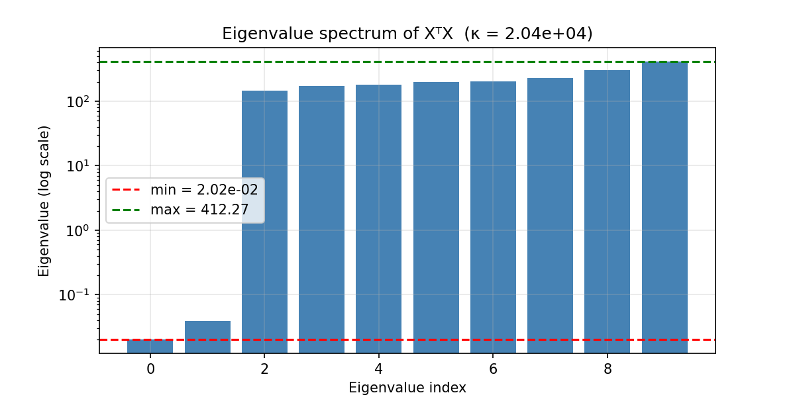
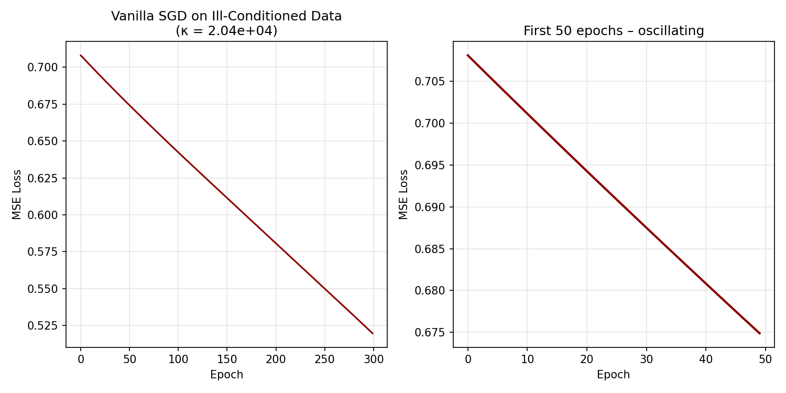

# Adaptive Stabilization Techniques for Ill-Conditioned Problems in ML

**Course**: AIMA 203 – Numerical Methods  
**Institution**: Kathmandu University, Nepal  
**Date**: May 2026  
**Authors**: Kushagra Poudel, Aman Sapkota, Utsab Baral

---

## Project Overview

Modern machine learning training is essentially **numerical computation**—we solve high-dimensional linear systems, compute matrix factorizations, and run iterative solvers. When the data or the Hessian is ill-conditioned (high condition number `κ`), naive algorithms like Vanilla SGD break down, causing gradient explosions, vanishing updates, and divergent training.

This project investigates **how ill-conditioning degrades ML performance** and experimentally compares adaptive stabilization techniques (Ridge regularization, Adam optimizer, and Batch Normalization) to restore numerical tractability.

---

## Progress Summary (Current Status)

We have successfully completed **Phase 1** and **Phase 2** of the project, establishing a solid baseline.

###  Phase 1: Generating Ill-Conditioned Data

**Objective**: Create a dataset with severe multicollinearity (`ρ > 0.95`) to artificially induce a high condition number in `XᵀX`.

**Methodology**:

- Generated 200 samples with 10 features.
- Artificially made feature pairs highly correlated (e.g., `x₁ ≈ 0.95·x₀`).
- Computed the Gram matrix `G = XᵀX` and its eigenvalue spectrum.

**Key Results**:

- **Condition Number**: `κ = 2.04 × 10⁴` (κ >> 1, severely ill-conditioned).
- Eigenvalues spanned from ~`10⁻⁴` to ~`10⁰` (log-scale spread).
- Direct inversion `np.linalg.inv(G)` failed numerically, proving the matrix is near-singular.

**Output File**: `eigenvalue_spectrum.png` – shows the wide eigenvalue spread, confirming the numerical instability.

---

###  Phase 2: Vanilla SGD Baseline (Control Experiment)

**Objective**: Train a simple 3-layer MLP on the ill-conditioned data using pure Vanilla SGD (no momentum, no adaptivity) to observe the "broken" behavior.

**Methodology**:

- Used the same dataset from Phase 1.
- Architecture: 10 → 64 → 64 → 1 (ReLU activations).
- Optimizer: `SGD(lr=0.001, momentum=0.0)`.
- Loss: MSE (Mean Squared Error).
- Epochs: 300.

**Key Results**:

- Loss decreased very slowly: `0.6749 → 0.5198` over 300 epochs.
- Loss curve showed **oscillations** (especially in the first 50 epochs), indicating that gradients are bouncing in steep directions and crawling in flat ones.
- Convergence is far from optimal—this confirms that ill-conditioning seriously degrades Vanilla SGD.

**Output File**: `vanilla_sgd_loss.png` – shows slow, oscillating convergence. This is our baseline "control" to beat with stabilization techniques.

---

## Visual Results

### 1. Eigenvalue Spectrum of `XᵀX`

_The eigenvalues span several orders of magnitude. The ratio (max/min) gives κ ≈ 2.04×10⁴, proving the system is ill-conditioned._

### 2. Vanilla SGD Loss Curve

_The loss decreases slowly and oscillates. This demonstrates that naive SGD cannot efficiently navigate the ill-conditioned landscape._

---

## Next Steps (Phases 3, 4, and 5)

| Phase | Technique                 | Type                     | Expected Improvement                                                                      |
| :---: | :------------------------ | :----------------------- | :---------------------------------------------------------------------------------------- |
| **3** | Ridge (L2) Regularization | Explicit Regularization  | Add `λI` to shift eigenvalues away from zero → reduce κ → smoother loss.                  |
| **4** | Adam Optimizer            | Adaptive Preconditioning | Per-parameter learning rates → diagonal Hessian preconditioning → faster, stable descent. |
| **5** | Batch Normalization       | Structural Stabilization | Rescale activations → bound Jacobian singular values → allow higher LR.                   |

**Final Goal**: Overlay all loss curves (SGD, Ridge, Adam, BN) on a single graph to visually demonstrate which numerical stabilization technique works best for ill-conditioned problems (matching Slide 11 of the presentation).

---

#
