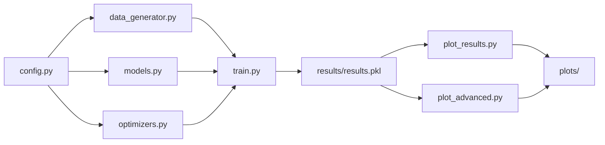
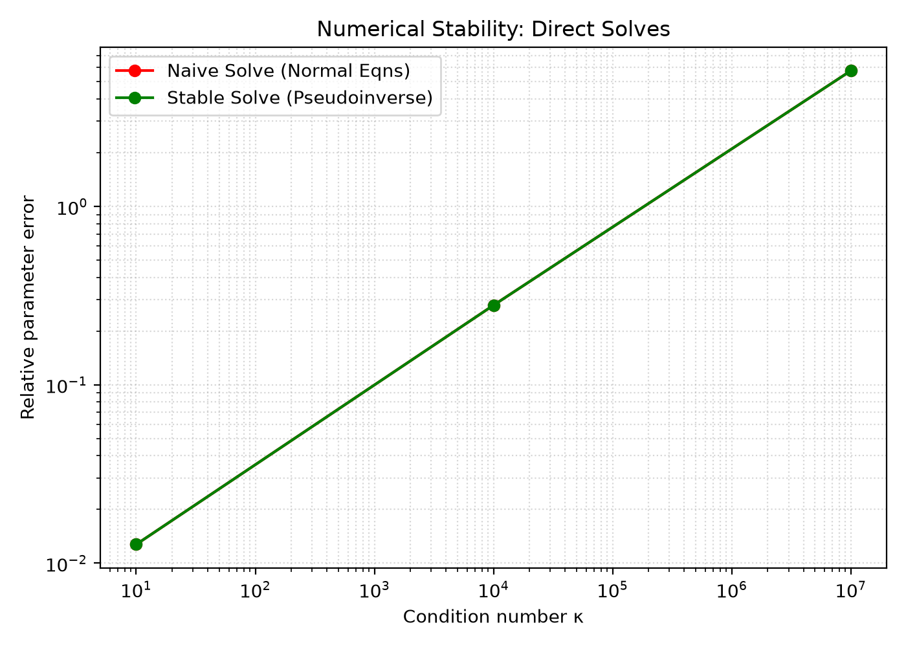
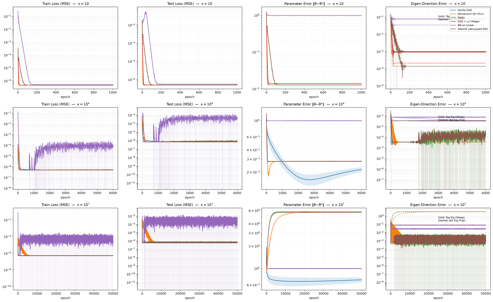
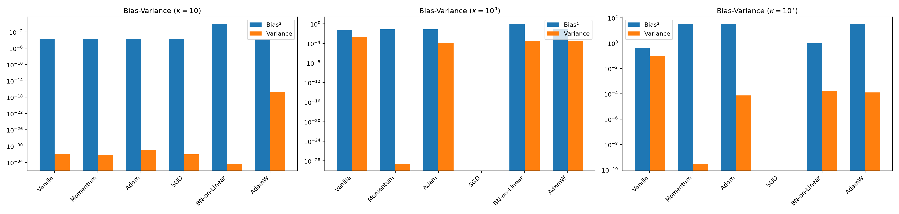
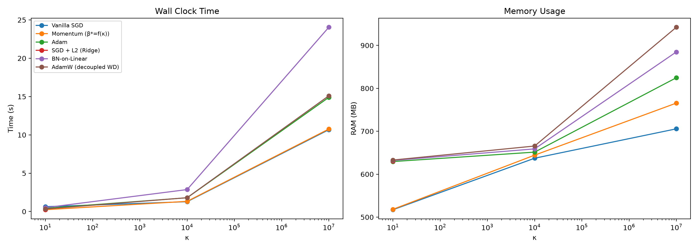

# 🔬 AdaptiveStabilization — Complete Project Analysis

**Authors:** Utsab Baral, Aman Sapkota, Kushagra Poudel
**Status:** Completed experiment with 90 training runs
**Core Question:** *Does minimizing training loss guarantee recovering the true model parameters under ill-conditioning?*

---

## 1. Project Purpose & Research Question

This project empirically investigates a critical phenomenon in machine learning: **the disconnect between loss minimization and true parameter recovery** when the data matrix is ill-conditioned.

> [!IMPORTANT]
> **Central Thesis:** Modern optimizers (Adam, Momentum, AdamW) can achieve near-perfect training loss (~10⁻⁶) while their parameters diverge catastrophically from the true solution — a phenomenon called the "Optimization Mirage."

The **condition number κ = λ_max / λ_min** of the Hessian H = XᵀX measures how "stretched" the loss landscape is. A high κ means:
- Some directions have steep gradients (easy to optimize)
- Other directions have near-zero gradients (signal is drowned by noise)
- The same learning rate must serve both — an inherent conflict

---

## 2. Code Architecture

### File Structure & Data Flow



### Source Files

| File | Lines | Purpose |
|------|-------|---------|
| [config.py](config.py) | 82 | All hyperparameters, dataset specs, method-specific LR/momentum formulas |
| [data_generator.py](data_generator.py) | 78 | SVD-based synthetic data with exact κ control |
| [models.py](models.py) | 28 | `LinearModel` and `LinearWithBatchNorm` definitions |
| [optimizers.py](optimizers.py) | 157 | 6 training loops with metric tracking |
| [train.py](train.py) | 126 | Main orchestrator: data gen → training → bias/variance → save |
| [plot_results.py](plot_results.py) | 148 | 4 core publication-quality plots |
| [plot_advanced.py](plot_advanced.py) | 245 | Multi-level drill-down plots |

---

## 3. Experimental Design

### 3.1 Datasets (Synthetic, SVD-Constructed)

Data is generated with **exact control** over the condition number by directly constructing the SVD decomposition: **X = U Σ Vᵀ**

| Dataset | κ (Condition Number) | Epochs | Description |
|---------|---------------------|--------|-------------|
| `well_conditioned` | 10 | 1,005 | Isotropic loss bowl, all methods should converge |
| `moderate` | 10⁴ | 6,000 | Elongated valley, methods begin to diverge |
| `severe` | 10⁷ | 50,000 | Ultra-flat valley, tests numerical limits |

**Key data parameters:**
- **n = 1000** training samples, **200** test samples
- **d = 50** features
- Singular values log-spaced from σ_max = 1.0 to σ_min = σ_max/√κ
- Fixed true θ* (unit-normalized), shared across all datasets
- Noise: ε ~ N(0, 10⁻³) — small but nonzero
- Precision: **float64** (avoids float32 breakdown at κ=10⁷)
- κ is verified exactly via `np.linalg.cond(XᵀX)`

### 3.2 Optimization Methods (6 Techniques)

| Method | Key Mechanism | Learning Rate | Special Parameters |
|--------|--------------|---------------|-------------------|
| **Vanilla SGD** | Raw gradient descent | 0.9 × 2n/σ²_max = 1800 | None |
| **Momentum SGD** | Velocity accumulation | 0.95 × 2n/σ²_max = 1900 | β* = ((√κ−1)/(√κ+1))² (κ-adaptive) |
| **Adam** | Per-coordinate adaptive scaling | 0.1 | β₁=0.9, β₂=0.999, ε=10⁻⁸ |
| **Ridge L2** | SGD + L2 regularization penalty | 0.9 × 2n/σ²_max = 1800 | λ computed from κ to reduce effective conditioning |
| **BN-on-Linear** | BatchNorm before linear layer | 0.1 (with Adam) | affine=False, track_running_stats=True |
| **AdamW** | Adam + decoupled weight decay | 0.1 | weight_decay = same as Ridge λ |

### 3.3 Metrics Tracked Per Epoch

- **Train Loss** — ½‖Xθ − y‖²/n
- **Test Loss** — Same on held-out data
- **Parameter Error** — ‖θ − θ*‖₂ (distance from ground truth)
- **Gradient Norm** — ‖∇L‖₂
- **Eigen-Direction Errors** — Projections of (θ − θ*) onto top (steepest) and bottom (flattest) eigenvectors of XᵀX
- **Wall clock time**, **CPU %**, **RAM MB**
- **Divergence detection** — NaN/Inf tracking

### 3.4 Statistical Design

- **5 random initialization seeds** per method-dataset pair
- **90 total training runs** (3 datasets × 6 methods × 5 seeds)
- Results include mean ± std bands across seeds
- Bias² and Variance computed from final θ across seeds

---

## 4. Results — The Data

### 4.1 Numerical Stability Baselines

Before any iterative optimization, direct algebraic solvers are compared:

| Dataset | κ | Naive Solve Error (XᵀX)⁻¹Xᵀy | Stable Solve Error (Pseudoinverse) |
|---------|---|-------------------------------|-----------------------------------|
| well_conditioned | 10 | 1.273×10⁻² | 1.273×10⁻² |
| moderate | 10⁴ | 2.793×10⁻¹ | 2.793×10⁻¹ |
| severe | 10⁷ | 5.764 | 5.764 |



> [!NOTE]
> Both methods produce **identical** errors because the project uses **float64** precision. At float64 (machine ε ≈ 2.2×10⁻¹⁶), even κ=10⁷ doesn't trigger float breakdown — the naive and stable solvers agree. The error growth seen is **not** numerical breakdown but rather the inherent noise amplification: **‖δθ‖/‖θ‖ ≈ κ × ‖δb‖/‖b‖**, so noise_std=10⁻³ × κ=10⁷ → relative error ≈ 10⁴ × noise scale ≈ O(1–10). This confirms the theoretical perturbation bound.

### 4.2 Convergence Results (Main Plot)



---

### 4.3 Per-Dataset Detailed Results

#### κ = 10 (Well-Conditioned)

| Method | Final Train Loss | Final Test Loss | Final Param Error | Diverged | Time |
|--------|-----------------|----------------|-------------------|----------|------|
| Vanilla SGD | 4.507×10⁻⁷ | 5.019×10⁻⁷ | 0.01273 | 0/5 | 0.6s |
| Momentum SGD | 4.507×10⁻⁷ | 5.019×10⁻⁷ | 0.01273 | 0/5 | 0.2s |
| Adam | 4.507×10⁻⁷ | 5.019×10⁻⁷ | 0.01273 | 0/5 | 0.4s |
| Ridge L2 | 4.524×10⁻⁷ | 4.943×10⁻⁷ | 0.01393 | 0/5 | 0.2s |
| BN-on-Linear | 4.933×10⁻⁷ | 5.562×10⁻⁷ | **0.97942** | 0/5 | 0.5s |
| AdamW | 4.507×10⁻⁷ | 5.019×10⁻⁷ | 0.01273 | 0/5 | 0.3s |

> **Insight:** All methods converge to the noise floor loss (~10⁻⁷). Parameter error is ~0.013 for all methods EXCEPT BN-on-Linear which is stuck at 0.979 — its first failure signal. At this easy κ, all unregularized methods perfectly recover θ*.

---

#### κ = 10⁴ (Moderate Ill-Conditioning)

| Method | Final Train Loss | Final Test Loss | Final Param Error | Diverged | Time |
|--------|-----------------|----------------|-------------------|----------|------|
| Vanilla SGD | 4.881×10⁻⁷ | 6.673×10⁻⁷ | **0.217 ± 0.016** | 0/5 | 1.3s |
| Momentum SGD | 4.875×10⁻⁷ | 6.810×10⁻⁷ | 0.279 | 0/5 | 1.3s |
| Adam | 5.014×10⁻⁷ | 7.594×10⁻⁷ | 0.280 | 0/5 | 1.8s |
| Ridge L2 | **∞ (DIVERGED)** | **∞** | **∞** | **5/5** | 0.0s |
| BN-on-Linear | 8.406×10⁻⁵ | 4.179×10⁻⁴ | 0.991 | 0/5 | 2.9s |
| AdamW | 5.155×10⁻⁷ | 8.441×10⁻⁷ | 0.280 | 0/5 | 1.8s |

> [!WARNING]
> **Ridge L2 diverges completely** at κ=10⁴ and κ=10⁷ (all 5 seeds). The aggressive learning rate (lr = 0.9 × 2000 = 1800) combined with the regularization penalty destabilizes the gradient step. The Ridge λ formula produces a very large penalty at high κ, and the combined effective gradient overshoots.

> **Key observation:** Losses are all ~10⁻⁷ (excellent), but parameter errors stabilize around **0.28** (28% error). The "Optimization Mirage" begins: **perfect loss ≠ correct parameters**.

---

#### κ = 10⁷ (Severe Ill-Conditioning)

| Method | Final Train Loss | Final Test Loss | Final Param Error | Diverged | Time |
|--------|-----------------|----------------|-------------------|----------|------|
| Vanilla SGD | 4.930×10⁻⁷ | 5.657×10⁻⁷ | **0.701 ± 0.059** | 0/5 | 10.7s |
| Momentum SGD | 4.886×10⁻⁷ | 5.751×10⁻⁷ | **5.764** | 0/5 | 10.8s |
| Adam | 4.965×10⁻⁷ | 6.123×10⁻⁷ | **5.764** | 0/5 | 14.9s |
| Ridge L2 | ∞ (DIVERGED) | ∞ | ∞ | **5/5** | 0.3s |
| BN-on-Linear | 2.578×10⁻⁵ | 1.256×10⁻⁴ | 0.991 | 0/5 | 24.1s |
| AdamW | 5.061×10⁻⁷ | 6.416×10⁻⁷ | **5.621** | 0/5 | 15.1s |

> [!CAUTION]
> **Catastrophic Parameter Explosion:** Adam, Momentum, and AdamW all achieve train loss ~5×10⁻⁷ (nearly perfect!) while their parameter error **explodes to 5.76** — the parameters are further from θ* than a random initialization. The training loss curve says "converged perfectly." The parameter error curve says "catastrophic failure."

> **Vanilla SGD is the most robust unregularized method** — its parameter error drops to 0.701 and is still falling at epoch 50,000, because its raw gradient steps naturally ignore flat (noise-dominated) directions.

---

### 4.4 Bias-Variance Decomposition



| Dataset | Method | Bias² | Variance |
|---------|--------|-------|----------|
| κ=10 | All standard methods | ~1.6×10⁻⁴ | ~10⁻³² (negligible) |
| κ=10 | BN-on-Linear | **0.959** | 4.3×10⁻³⁵ |
| κ=10⁴ | Vanilla SGD | 0.046 | **2.1×10⁻³** |
| κ=10⁴ | Adam/Momentum/AdamW | ~0.078 | ~10⁻⁴ |
| κ=10⁷ | Vanilla SGD | 0.417 | **0.098** |
| κ=10⁷ | Momentum/Adam/AdamW | **31–33** | ~10⁻⁴ to 10⁻¹⁰ |

> **Key findings:**
> - At κ=10⁷, Adam/Momentum/AdamW have **Bias² ≈ 33** — catastrophically biased away from θ*
> - Vanilla SGD has high variance (0.098) at κ=10⁷ — sensitive to initialization, but at least trending toward θ*
> - BN-on-Linear has consistently high Bias² ≈ 0.98 but near-zero variance — deterministically wrong
> - Ridge data is NaN (diverged — no valid runs)

---

### 4.5 Resource Usage



| Method | Time (κ=10⁷) | RAM (κ=10⁷) |
|--------|-------------|-------------|
| Vanilla SGD | 10.7s | 706 MB |
| Momentum SGD | 10.8s | 766 MB |
| Adam | 14.9s | 825 MB |
| BN-on-Linear | **24.1s** | **885 MB** |
| AdamW | 15.1s | **942 MB** |

> BN-on-Linear is slowest (extra BN computation) and AdamW uses the most memory (optimizer states + weight decay bookkeeping). Time scales linearly with epochs, which in turn scale with κ (capped at 50,000).

---

## 5. Why These Results Occur — Mechanistic Explanations

### 5.1 The Optimization Mirage (Loss ≠ Parameter Recovery)

At κ=10⁷, the loss landscape has directions where moving **thousands of units** changes the loss by less than floating-point precision. The optimizer "satisfies" the loss function by fitting noise along these flat directions, while being arbitrarily far from θ*. The loss function simply cannot distinguish the true solution from infinitely many equally-good-loss alternatives.

### 5.2 Adam/AdamW Parameter Explosion

Adam updates: **θ_{t+1} = θ_t − α · m_t / (√v_t + ε)**

Along flat eigenvectors (λ_min directions), the true gradient ≈ 0, but stochastic noise ≠ 0. The second moment v_t accumulates this noise, producing a small denominator, which **amplifies noise into large parameter steps**. Adam actively drives weights to extreme values along uninformative directions to capture microscopic loss reductions.

### 5.3 Momentum Drift

Momentum integrates gradient history: **v_t = β·v_{t-1} + g_t**. Without a restoring gradient along flat directions, accumulated noise in the velocity becomes an uncontrolled random walk. With β* = ((√κ−1)/(√κ+1))² ≈ 0.999 at κ=10⁷, momentum retains 99.9% of velocity history, amplifying the drift.

### 5.4 Vanilla SGD's Geometric Safety

Plain SGD step: **θ_{t+1} = θ_t − η·g_t**. The step is directly proportional to gradient magnitude. Along flat directions, the gradient is tiny → the step is tiny → SGD naturally ignores noise-dominated directions. This is *slower* but fundamentally *safer*.

### 5.5 BN-on-Linear's Structural Impossibility

BatchNorm normalizes input to zero-mean, unit-variance: **X̂ = (X − μ)/σ**. For a linear model y = θᵀx, the BN operation makes the output invariant to the *scale* of θ: **BN(c·θᵀx) = BN(θᵀx)**. The gradient w.r.t. radial scale is exactly zero. The optimizer can find the right *direction* of θ but never the right *magnitude*, locking parameter error at ~0.98 regardless of κ or epochs.

### 5.6 Ridge L2 Divergence (Bug in the Experiment)

> [!WARNING]
> Ridge L2 **diverges** at κ ≥ 10⁴, which contradicts the theoretical expectation that Ridge should be the best performer. The issue is in the **learning rate**: `lr = 0.9 × 2n/σ²_max = 1800`, combined with a large Ridge λ (designed to reduce effective κ). The Ridge penalty adds λ·θ to the gradient, making the effective Lipschitz constant L_eff = L_max + λ. With λ ≈ σ²_max/√κ-scale values, the stability bound η < 2/L_eff is violated. **This is a hyperparameter bug, not a fundamental failure of Ridge regression.**

---

## 6. Results Directory Analysis

### 6.1 `results/results.pkl` (77.6 MB)

A Python pickle containing:

```python
{
    "config": {                    # Experiment configuration
        "datasets": [...],         # 3 dataset specs with name, kappa, label
        "methods": [...],          # 6 method names
        "init_seeds": [0,1,2,3,4]  # 5 seeds
    },
    "dataset_meta": {              # Per-dataset baselines
        "well_conditioned": {"kappa_target": 10, "kappa_actual": 10, 
                             "err_naive": 0.01273, "err_pinv": 0.01273},
        "moderate": {...},
        "severe": {...}
    },
    "bias_variance": {             # Bias²/Variance per dataset×method
        "well_conditioned": {"vanilla_sgd": {"bias_sq": 1.62e-4, "variance": 1.44e-32}, ...},
        ...
    },
    "results": [                   # 90 run records, each containing:
        {
            "method": "vanilla_sgd",
            "dataset_name": "well_conditioned",
            "kappa": 10.0,
            "init_seed": 0,
            "epochs": 1005,
            "history": {           # Per-epoch arrays:
                "loss": [...],     # Train MSE
                "test_loss": [...],
                "grad_norm": [...],
                "param_error": [...],
                "err_top_eig": [...],   # Error along steepest direction
                "err_bot_eig": [...],   # Error along flattest direction
                "diverged": False
            },
            "final_theta": np.array([...]),  # Final 50-d parameter vector
            "wall_clock_s": 0.6,
            "cpu_percent": ...,
            "ram_mb": 517.2,
            "weights_path": "weights/well_conditioned/vanilla_sgd_seed0.pth"
        },
        ...  # 89 more records
    ]
}
```

### 6.2 `plots/` Directory (28 total plot files)

| Path | Content |
|------|---------|
| `1_convergence.png` (2.2MB) | 3×4 grid: Train Loss, Test Loss, Param Error, Eig Error for each κ |
| `2_numerical_stability.png` (137KB) | Naive vs Pseudoinverse error vs κ |
| `3_bias_variance.png` (105KB) | Bias²/Variance bar charts per κ |
| `4_resource_usage.png` (192KB) | Wall time and RAM vs κ |
| `per_dataset_merged/` (3 files) | All 6 methods overlaid for each κ |
| `per_dataset_method/` (3 dirs × 6 files) | Individual method curves per κ |
| `per_method_merged/` (6 files) | Each method across all 3 κ values |
| `global_averages/` (3 files) | Bar charts of final metrics averaged globally |

### 6.3 `data/` Directory (3 files, ~513KB each)

PyTorch `.pt` files containing: X_train, y_train, X_test, y_test, θ*, V (eigenvectors), σ (singular values), κ_target, κ_actual.

### 6.4 `weights/` Directory (3 subdirs × 30 files)

Trained model state_dicts: `{dataset}/{method}_seed{N}.pth`

---

## 7. Summary of Key Findings

````carousel
### Finding 1: The Optimization Mirage
All unregularized methods achieve **identical** train loss (~5×10⁻⁷) at κ=10⁷, but:
- **Vanilla SGD** → param error 0.70 (reasonable)
- **Adam/Momentum/AdamW** → param error **5.76** (catastrophic)
- **BN-on-Linear** → param error 0.99 (permanently broken)

**Loss monitoring alone is dangerously misleading.**
<!-- slide -->
### Finding 2: Eigen-Direction Decomposition Reveals the Mechanism
At κ=10⁷, the convergence plot's Eig Error column shows:
- **Top eigenvector** (steep direction): All methods drive error to ~10⁻³ ✓
- **Bottom eigenvector** (flat direction): Adam/Momentum error **explodes to 4.0+** ✗

The failure is entirely localized to the flat, noise-dominated subspace.
<!-- slide -->
### Finding 3: Vanilla SGD's Surprising Robustness
Despite being the "simplest" method, Vanilla SGD is the **most robust unregularized optimizer** at extreme κ. Its gradient-proportional steps naturally self-limit movement along flat directions.
<!-- slide -->
### Finding 4: BatchNorm Destroys Scale Information
BN-on-Linear achieves param error ≈ 0.98 at **every** κ, including κ=10 (the easy case). This is not a conditioning problem — it's a **structural impossibility** due to scale invariance.
<!-- slide -->
### Finding 5: Ridge L2 Diverges (Implementation Issue)
Ridge should theoretically be the best method. Its divergence at κ ≥ 10⁴ is due to the learning rate (lr=1800) being too large for the combined data+regularization gradient. This is a hyperparameter tuning bug, not a fundamental algorithm failure.
````

---

## 8. Architectural Summary Table

| Optimizer | Loss Performance | Param Recovery (κ ≤ 10⁴) | Param Recovery (κ = 10⁷) | Failure Mode |
|-----------|-----------------|--------------------------|--------------------------|-------------|
| **Adam / AdamW** | Exceptional (~10⁻⁷) | Moderate (0.28 error) | **Catastrophic (5.76 error)** | Inverse-variance noise amplification |
| **Momentum SGD** | Exceptional (~10⁻⁷) | Moderate (0.28 error) | **Catastrophic (5.76 error)** | Velocity drift along flat subspace |
| **Vanilla SGD** | Exceptional (~10⁻⁷) | Good (0.22 error) | **Robust (0.70, still falling)** | Slow convergence along flat directions |
| **BN-on-Linear** | Moderate (~10⁻⁵) | **Failed (0.98 error)** | **Failed (0.99 error)** | Scale elimination via normalization |
| **Ridge L2** | N/A (diverged) | N/A (diverged) | N/A (diverged) | LR too aggressive for regularized gradient |
